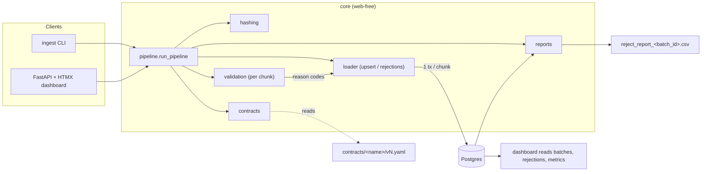

# Ingest Platform

Batch file ingestion front door for an internal ops/data team: drop a CSV/Excel
extract, have it validated against a versioned schema contract, land only the
trusted rows in Postgres — and keep every rejected row with queryable reasons.
Partial success, idempotent reprocessing, and an audit trail are built in.

## Architecture

One Python package with a web-free core; the CLI and the FastAPI app are thin
wrappers that call the same pipeline function.



Uploads are hashed (SHA-256) and stored under `data/uploads/<sha256>/`; the file
streams in chunks, each validated with element-wise checks that collect every
failure, then loaded in its own transaction. See [`docs/architecture.md`](docs/architecture.md)
for the component table, data flow and idempotency layers.

## Quick start

```bash
docker compose up            # app on :8000, Postgres on :5432 (runs migrations on start)
ingest contracts validate    # lint every contract
ingest upload file.csv --contract paysim_transactions
```

Local development without Docker:

```bash
uv sync
uv run uvicorn ingest.api.main:app --reload   # dashboard at http://127.0.0.1:8000
```

Demo data comes from public Kaggle datasets (PaySim mobile-money transactions,
USA Banking Transactions, Bank_Dataset for reference tables) — verify each
dataset's license on its Kaggle page. Datasets are never committed; see
`data/` (git-ignored). `scripts/make_dirty_sample.py` turns a clean sample
into a predictably dirty one for demos and manual checks.

## Design decisions and trade-offs

- **Idempotency over file names.** Identity is the SHA-256 of content, enforced
  by a unique constraint, so the same file can never create two batches — even
  under concurrent uploads. Rows upsert on a deterministic `row_key`.
- **Partial success by default.** Each chunk loads in its own transaction, so
  good rows commit even when other rows fail. A chunk-level database error
  becomes per-row `LOAD_ERROR` rejections instead of a lost batch.
- **Queryable rejections, readable exports.** Storage is one row per
  (record, reason) for filtering by code/column; the CSV export aggregates back
  to one row per record with joined codes and messages plus the full original
  row, so nobody cross-references.
- **Contracts as code.** Validation lives in versioned YAML (`contracts/<name>/v<N>.yaml`),
  never in hardcoded checks. Fixing a rule means a new version; reprocessing a
  batch under the new version lands the previously rejected rows without
  duplicating anything already loaded.
- **One pipeline function.** The CLI and the API call the same
  `run_pipeline`; the dashboard is server-rendered (Jinja2 + HTMX), no JS build.

## Workspace features

The dashboard is a data-platform workspace (layout benchmarked against Microsoft
Fabric and Databricks; see [`docs/ui-benchmark.md`](docs/ui-benchmark.md)).

| Area | What you can do |
|---|---|
| **Runs** | Run history with a 14-day outcome chart, filters (status, contract, time range) and global search (`/`). |
| **Add data** | Upload CSV/Excel and **Ingest**, or **Validate only**: a dry run that shows what would load or be rejected and loads nothing. |
| **Batch** | Reason breakdown, rejected records, lineage, reprocess. Download the rejected rows **as the original file** (CSV or Excel) to fix and re-upload, or **Fix rows** in an in-app grid: edit, re-validate, resubmit as a new batch. |
| **Contracts** | Create from a form, from YAML, or **drafted from a sample file or a database table**. Editing always writes the next version; an unused version can be deleted. Tabs for columns, rules, version diffs, runs and quality. |
| **Tables** | Every target table (one table collects every upload under its contract): browse, search, schema, loads, and **export** as CSV, Excel, JSON or Parquet. |
| **SQL editor** | Read-only queries over the app database or any connection, with export. |
| **Connections** | PostgreSQL, SQL Server or SQLite. Use a table (or a read-only query) as a **source** to validate or import, or make it a contract's **destination** (`target.connection`) so accepted rows load there. |

Connection passwords are encrypted at rest with `INGEST_SECRET_KEY` (a Fernet key), or a
key generated once into `data/.secret_key`. SQL Server needs the optional driver:
`uv sync --extra sqlserver` (the Docker image includes it).

## Known limitations

- Excel files read fully into memory; files over 50 MB are rejected — convert
  to CSV first.
- No message queue: API uploads run as FastAPI background tasks in-process.
- Memory stays flat on large CSVs (chunked streaming). Peak memory on a
  1,000,000-row, 34 MB PaySim-shaped CSV: **145 MB peak working set** for the
  whole process (105 MB before the run), loaded in **52 s (~19,000 rows/s)**
  against Postgres 16 in Docker Desktop, 10,000-row chunks. The Kaggle PaySim
  file itself was not on disk, so a synthetic same-shape file was used as an
  honest substitute (see test_logbook).
- Out of scope for v1: multi-tenancy, streaming, resumable uploads, RBAC,
  scheduled ingestion. (In-app correction of rejected rows was added on
  2026-10-20; see `docs/decisions.md`.)
- No authentication: anyone who can reach the dashboard can author contracts,
  register connections and run read-only SQL. Run it on a trusted network.
- Destination databases: target rows and the audit trail (rejections, chunks)
  commit in two transactions. A crash between them can leave a chunk's rows in
  the destination without its audit record; reprocessing is safe because the
  upsert is keyed on `row_key`.
- The SQL editor's read-only guarantee is enforced by Postgres and SQLite. SQL
  Server has no read-only transaction, so connect it with a read-only login.
  On Postgres, set `INGEST_QUERY_ROLE` to a SELECT-only role so the editor never
  runs with superuser rights.
- The fix grid edits up to 2,000 rejected rows at a time; for more, download the
  rows and fix them in a spreadsheet. Table exports to Parquet are built in memory.
